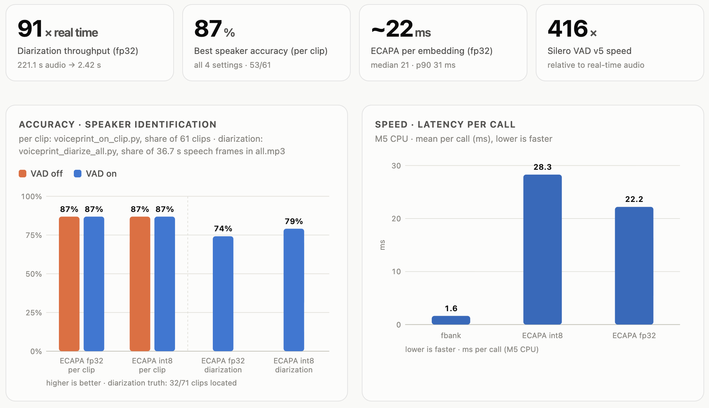

# EdgeVoiceprintForUnity

Low-latency, on-device speaker identification (voiceprint) for Unity — **who is speaking, and their voice
separated per speaker turn**, running fully offline with ONNX Runtime. Built for Meta Quest
(Android) and also runs on Windows and macOS (see Release files).

The repository holds both halves of the project:
- **Unity** (`UnityVoicePrint/`) — the runtime library and a uGUI demo scene.
- **Python** (`pretrained_model_convert/`, `test_result/`) — model export to ONNX,
  accuracy tests. **Deployment does not depend on a Python environment**.


## Calculation Pipline
```
microphone ─► Silero VAD v5 ─► log-mel fbank ─► ECAPA-TDNN ─► cosine on enrolled voice library
               (streaming)           (80 mel)       (192-d)       ─► identy speaker / Unknown & ouput clean audio
            human voice segment
              (≤ 2 s pieces)
```

## Benchmark

Measured with `python -m test_result.benchmark` (Apple M5, onnxruntime 1.31, 1 CPU thread,
3 speakers, first 3 clips of each speaker enrolled). See `test_result/Voiceprint Benchmark.html`.



Real-time pipeline in Unity (streaming replay of the same conversation through the actual
`AudioRecorder` segmentation and `VoicePrintManager`): **68 % correct, 7 % wrong speaker, 17 % Unknown,
8 % missed**, result ~0.36 s after the utterance ends.


## Installation

Install via Unity Package Manager:
1. In the Unity Editor, open the Package Manager by navigating to Window > Package Manager.
2. Add (+) button in the top-left corner of the Package Manager toolbar.
3. Select Add package from git URL.

The VAD and ONNX Runtime Engine come from
[SileroVADForUnity](https://github.com/DIAOZHUO/SileroVADForUnity), so install it first
(Add package from git URL: `https://github.com/DIAOZHUO/SileroVADForUnity.git`).

Then Add this repo: https://github.com/DIAOZHUO/EdgeVoiceprintForUnity.git?path=/UnityVoicePrint/Packages/com.enzian.voiceprint

4. (quick getting start) In the Package Window, Samples > import "VoicePrint Demo" Scene, then open
   `Assets/Samples/Edge Voiceprint for Unity/1.0.0/VoicePrint Demo/VoicePrintDemo.unity` and press Play.


## Usage

```csharp
var vp = VoicePrintManager.Instance;

// To get one event per speaker turn: the turn's clean speech (mono 16 kHz) and who said it
vp.OnSpeechIdentified += (float[] audio, string speaker) =>
{
    Debug.Log($"{speaker}: {audio.Length / 16000f:F1}s");   // speaker = enrolled name or "Unknown"
};

// To add a person to the voice library
await vp.EnrollAsync("alice", aliceClip);                     // AudioClip or float[] (mono 16 kHz)
```

Speakers can also be pre-enrolled from AudioClips in the Inspector (*Preset Speakers*), and the speaker library
is saved to `Application.persistentDataPath`. (library will be auto-saved)

Recommended `AudioRecorder` settings for conversation are
`DetectThreshold 0.7`, `SilentTimeInterval 0.3`, `MaxSegmentSeconds 4` (the prefab defaults are tuned for
single utterances). 


## Models

| Model | Source | License |
|---|---|---|
| ECAPA-TDNN speaker embedding | [speechbrain/spkrec-ecapa-voxceleb](https://huggingface.co/speechbrain/spkrec-ecapa-voxceleb), exported by `run.py` (fp32 + dynamic INT8) | Apache-2.0 |
| Silero VAD v5 | [snakers4/silero-vad](https://github.com/snakers4/silero-vad) | MIT |
| ONNX Runtime | [microsoft/onnxruntime](https://github.com/microsoft/onnxruntime) | MIT |

Unity ships the INT8 model (21 MB); it scores the same as fp32 here. The fp32 model stores its weights in
`ecapa_tdnn.onnx.data`, which ONNX Runtime cannot load from memory; `export_unity.py --fp32` writes a merged
single-file copy if you need it in Unity.

## Tips and Limitations

- Overlapping speech is not separated; a piece is assigned to one speaker.
- Very short utterances (< 1 s) and whispers / non-speech vocalisations are often Unknown or wrong.
- Accuracy depends mostly on enrollment: use 3–5 s or more of clean speech per speaker, ideally recorded with the
  same microphone that is used for identification.


## Related

- [SileroVADForUnity](https://github.com/DIAOZHUO/SileroVADForUnity) — the VAD / microphone package this
  project builds on.
